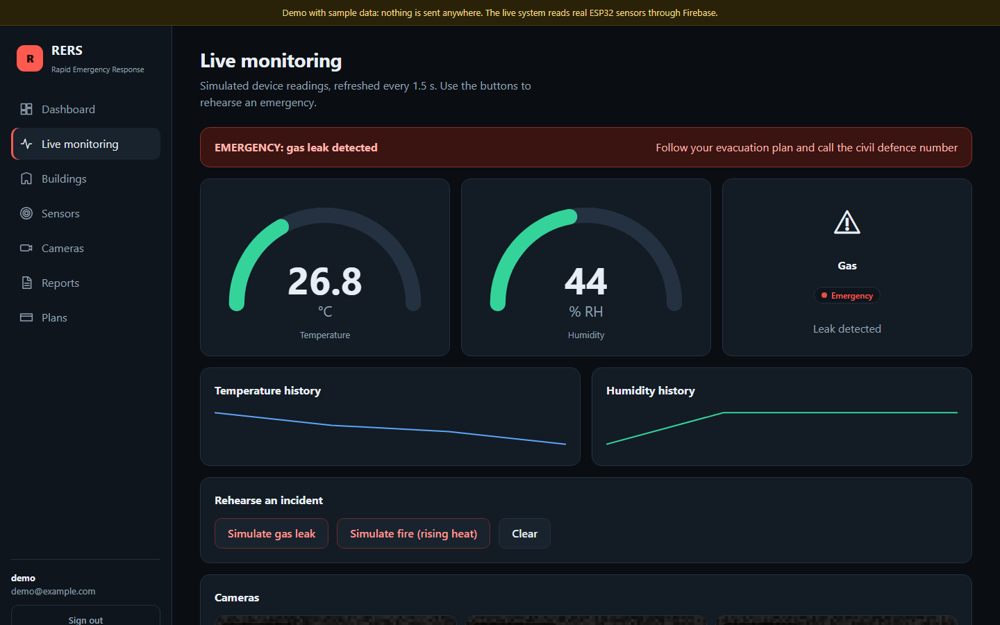
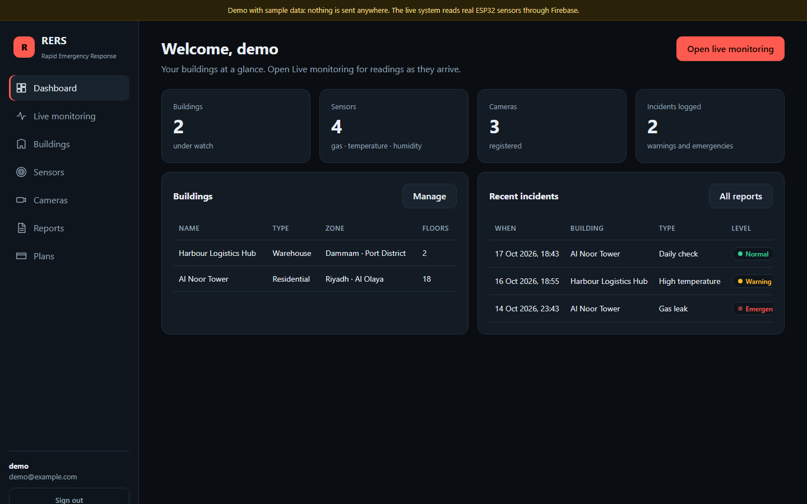
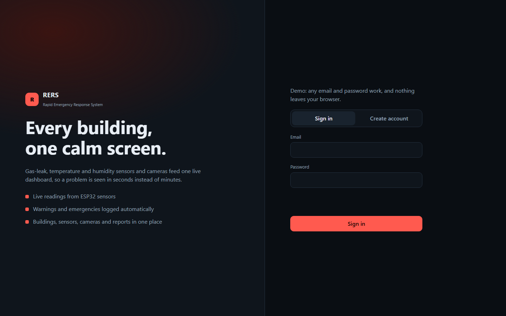

<div align="center">

# RERS · Rapid Emergency Response System

**One calm screen for building safety: live gas, temperature and humidity readings, cameras and incident reports.**

[](https://faisalalghates.github.io/RERS_TEAM/)


**[Live demo](https://faisalalghates.github.io/RERS_TEAM/)** · [Features](#features) · [Run it](#run-it) · [Hardware](#hardware-esp32) · [Architecture](#architecture)



</div>

## What it is

RERS watches buildings through ESP32 sensors and security cameras and shows everything on one dashboard. A gas leak or dangerous heat turns the screen red, is written to the incident log, and can be exported for review.

> **Try it now.** The [live demo](https://faisalalghates.github.io/RERS_TEAM/) runs in your browser with sample data: any email and password work, nothing is sent anywhere, the readings and cameras are simulated, and the **Rehearse an incident** buttons trigger a gas leak or a fire.

## Features

| Area | What you get |
| --- | --- |
| **Live monitoring** | Temperature and humidity gauges with history, gas-leak status, a banner that turns *Warning* or *Emergency*, and camera tiles |
| **Buildings** | Name, type, zone, floors, entrances and exits |
| **Sensors** | Gas-leak, temperature and humidity sensors, tied to a building, a location and a device |
| **Cameras** | Cameras per building with their stream address |
| **Incident reports** | Every warning and emergency is logged with the readings at that moment; CSV export |
| **Accounts** | Sign up and sign in (Firebase Auth in live mode) |
| **Plans** | Plan layout only; no payment is taken |

<table>
<tr>
<td></td>
<td></td>
</tr>
</table>

## Run it

```bash
npm install
npm start          # http://localhost:3000, demo mode
```

Open `http://localhost:3000/?mode=firebase` to use the real backend: **Firebase Auth** for accounts, **Firestore** for `buildings`, `sensors`, `cameras`, `reports` and `users`, and the **Realtime Database** paths the ESP32 writes: `/house/temp`, `/house/humidity` and `/house/gas-leak`. The Firebase web config lives in `JS/firebase.js`.

The dashboard in `web/` is a single-page app with no build step. The first version's pages are kept in `legacy-web/`.

> The alert thresholds in `web/config.js` are editable defaults for the demo, not certified safety limits.

## Hardware (ESP32)

`esp_code.txt` is the Arduino sketch: copy it into the Arduino IDE, install the Firebase ESP Client and DHT libraries, and fill in your own Wi-Fi and Firebase details (they are placeholders in this repository).

| Part | Pin |
| --- | --- |
| Gas sensor (digital out) | GPIO 27 |
| DHT11 temperature and humidity | GPIO 26 |

Every two seconds the board writes the gas state, temperature and humidity to the Realtime Database.

## Architecture

```text
 ESP32 + DHT11 + gas sensor ──▶ Firebase Realtime Database ──▶ RERS web dashboard
                                Firebase Auth · Firestore ◀──▶ (buildings, sensors, cameras, reports)
```

## Security

- The Wi-Fi password and the device account's email and password were once committed in `esp_code.txt`. They have been removed from the current file, but they remain in the git history: **change them**, and rotate the Firebase device account.
- Set Firebase security rules so only signed-in users can read or write their own data.
- The Firebase *web* config is not a secret, but it only protects anything if the rules above are in place.

## Roadmap

- Notifications by SMS and email, role-based access control
- AI video analysis, interactive 3D building view, mobile app
- More sensor types and multi-building scaling

## License

Available for educational and portfolio purposes.
